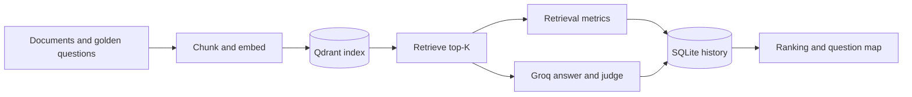
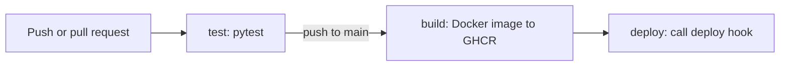

<div align="center">

# RAGBench

**Stop guessing which RAG setup works. Measure it.**

Benchmark embedding models, chunk sizes and top-K on your own documents, then see exactly which questions your retrieval gets wrong.


[Quick start](#quick-start) · [Features](#features) · [Use your own data](#using-your-own-data) · [Scoring](#how-scoring-works) · [API](#api-reference) · [CI/CD pipeline](#cicd-pipeline)


</div>

---

## Why RAGBench

Most RAG demos work on the three questions their author tried. Real pipelines fail quietly: the wrong chunk size splits the answer in half, a weaker embedding model ranks the right passage fourth, and the language model then answers confidently from the wrong text.

RAGBench makes that visible. You bring documents and a small set of questions with known answers. It indexes your documents under every configuration you pick, runs every question against every one, and shows you a ranking plus a question-by-question map of what worked and what failed.

## Features

| | |
|---|---|
| **Side-by-side comparison** | Compare up to 12 combinations of embedding model, chunk size and top-K in one run. |
| **Retrieval metrics** | Precision@K, Recall@K, hit rate, MRR and latency. These need no API key. |
| **Answer quality (optional)** | Faithfulness, relevancy and correctness, scored by an LLM judge on Groq (LLaMA 3.3 70B). |
| **Failure analysis** | Every question is labelled: answered well, retrieval miss, hallucination or incorrect answer. |
| **Question map** | A grid of questions against configurations. Click any dot to see the chunk that was retrieved, the expected answer and the model's answer. |
| **Your data** | Upload `.txt` or `.pdf` documents and a golden question CSV, or try the bundled EU sample. |
| **Run history** | Every run is saved to SQLite and shown under "Past runs". |
| **Ships with tooling** | Unit tests, Dockerfile, Docker Compose and a GitHub Actions CI/CD pipeline. |

<div align="center">

</div>

## How it works



1. Each document is split into word-based chunks with a configurable overlap.
2. Chunks are embedded with a Sentence Transformers model and stored in Qdrant, one index per model and chunk size.
3. Each golden question retrieves its top-K chunks. A chunk counts as relevant if it comes from the expected source file and contains the evidence phrase.
4. Retrieval metrics are computed per question and averaged per configuration.
5. If you turn on answer judging, Groq writes an answer from the retrieved chunks and a second call scores it.
6. Results are stored in SQLite and rendered as a ranking, a question map and a history table.

## Quick start

**Requirements:** Python 3.11 or newer. A Groq API key is optional and only needed for answer judging.

```bash
git clone https://github.com/<your-username>/ragbench.git
cd ragbench

python -m venv .venv
source .venv/bin/activate          # Windows: .venv\Scripts\activate

pip install -r requirements.txt

cp .env.example .env               # Windows: copy .env.example .env
# optional: add your GROQ_API_KEY to .env

uvicorn main:app --reload
```

Open **http://localhost:8000** and press **Run benchmark**.

> The first run downloads the embedding models from Hugging Face (roughly 100 MB to 500 MB depending on the models you pick), so allow a minute or two. Later runs reuse them.

### With Docker

```bash
export GROQ_API_KEY=your_key_here  # optional; Windows PowerShell: $env:GROQ_API_KEY="your_key_here"
docker compose up --build
```

This starts the app on port 8000 and a Qdrant server on port 6333. Run history is kept in a Docker volume.

### Configuration

| Variable | Default | Purpose |
|---|---|---|
| `GROQ_API_KEY` | none | Enables answer generation and judging. |
| `GROQ_MODEL` | `llama-3.3-70b-versatile` | Groq model used for answers and judging. |
| `QDRANT_URL` | none (in-memory) | Use a running Qdrant server instead of the built-in in-memory index. |
| `DB_PATH` | `rageval.db` | Where the SQLite history file is stored. |

## Using your own data

In the app, open **Use your own data** and add your documents and a golden CSV **together**. Leave both empty to use the bundled sample about GDPR, the EU AI Act and the euro.

Your golden CSV needs these columns:

| Column | Meaning |
|---|---|
| `question` | The question to ask. |
| `reference_answer` | The correct answer, used by the judge. |
| `source` | The file name of the document that contains the answer, for example `gdpr.txt`. It must match an uploaded file name. |
| `evidence` | A short phrase that appears in the relevant passage. Leave it empty to count any chunk from `source` as relevant. |

```csv
question,reference_answer,source,evidence
How soon must a data breach be reported under GDPR?,Within 72 hours of becoming aware of it.,gdpr.txt,within 72 hours
What is the maximum GDPR fine?,"Up to 20 million euros or 4 percent of worldwide annual turnover, whichever is higher.",gdpr.txt,4 percent
```

**Tip:** pick evidence phrases that are short and exact. If a phrase is split across two chunks by a small chunk size, that chunk is not counted as relevant, and the benchmark will show it as a miss. That is useful signal about your chunk size.

## How scoring works

### Retrieval metrics

| Metric | Definition |
|---|---|
| **Hit rate** | Share of questions where at least one relevant chunk is in the top-K. |
| **MRR** | Mean of 1 divided by the rank of the first relevant chunk (0 if none is found). The ranking is sorted by this. |
| **Precision@K** | Relevant chunks retrieved, divided by K. |
| **Recall@K** | Relevant chunks retrieved, divided by all relevant chunks in the index for that question. |
| **Latency** | Milliseconds per question: retrieval, plus answer generation when judging is on. |

### Answer quality (optional, needs `GROQ_API_KEY`)

| Metric | Question the judge answers |
|---|---|
| **Faithfulness** | Is every claim in the answer supported by the retrieved chunks? |
| **Relevancy** | Does the answer address the question? |
| **Correctness** | Does the answer match the reference answer? |

Scores run from 0 to 1 with temperature 0. If the judge returns something that cannot be parsed, that question is skipped for those three metrics instead of failing the run.

### Failure labels

| Label | Rule |
|---|---|
| **Retrieval miss** | No relevant chunk in the top-K. |
| **Hallucination** | A relevant chunk was found, but faithfulness is below 0.5. |
| **Incorrect answer** | A relevant chunk was found, but correctness is below 0.5. |
| **Answered well** | None of the above. |

### Limits

- At most **12 configurations** per run.
- With answer judging on, at most **60 question runs** (configurations multiplied by questions), because judging makes two API calls per question and free-tier Groq rate limits are tight.
- Overlap must be smaller than the smallest chunk size.

## API reference

The web page is a thin client over a small FastAPI service.

| Method | Path | Description |
|---|---|---|
| `GET` | `/api/options` | Available embedding models and whether a Groq key is configured. |
| `GET` | `/api/history` | Saved runs, newest first. |
| `POST` | `/api/run` | Run a benchmark. Multipart form. |

`POST /api/run` fields:

| Field | Required | Notes |
|---|---|---|
| `models` | yes | Comma-separated model ids from `/api/options`. |
| `sizes` | yes | Comma-separated chunk sizes in words, for example `40,150`. |
| `ks` | yes | Comma-separated top-K values, for example `3`. |
| `overlap` | no | Words of overlap between chunks. Default `10`. |
| `use_llm` | no | `true` to generate and judge answers. Default `false`. |
| `docs` | no | One or more `.txt` or `.pdf` files. Send together with `golden`. |
| `golden` | no | The golden CSV. Send together with `docs`. |

```bash
curl -X POST http://localhost:8000/api/run \
  -F models=sentence-transformers/all-MiniLM-L6-v2 \
  -F sizes=40,150 -F ks=3 -F overlap=10
```

The response is `{"summary": [...], "detail": [...]}`: one summary row per configuration and one detail row per question and configuration. Validation problems return HTTP 400 with `{"detail": "..."}` explaining what to fix.

Interactive docs are available at **http://localhost:8000/docs**.

## Project structure

```
ragbench/
├── main.py                  FastAPI app: API routes, input validation, serves the web page
├── rageval/
│   └── core.py              Chunking, Qdrant indexing and retrieval, metrics, Groq judge, SQLite storage
├── web/
│   └── index.html           The whole front end (HTML, CSS and JavaScript, no build step)
├── data/
│   ├── golden.csv           Nine sample questions
│   └── sample/              GDPR, EU AI Act and euro sample documents
├── tests/
│   └── test_core.py         Unit and API tests
├── Dockerfile
├── docker-compose.yml       App plus a Qdrant server
├── requirements.txt
└── .github/workflows/
    └── ci-cd.yml            Test, build and deploy pipeline
```

## Tests

```bash
python -m pytest -q
```

Eight tests cover chunking, every retrieval metric, failure labelling, a full benchmark run with a stand-in retriever, a real Qdrant round trip, input validation, document and CSV uploads, the judge (including an unparseable reply) and saved history. They run without network access or API keys.

## CI/CD pipeline

`.github/workflows/ci-cd.yml` runs on every push and pull request.



| Job | Runs when | What it does |
|---|---|---|
| `test` | every push and pull request | Installs dependencies and runs `pytest`. |
| `build` | push to `main`, after tests pass | Builds the Docker image and publishes it to GitHub Container Registry as `ghcr.io/<owner>/<repo>`. |
| `deploy` | after `build` | Calls a deploy hook so your host pulls the new image. Skipped until the secret below exists. |

To enable deployment, add a repository secret named `RENDER_DEPLOY_HOOK` under **Settings, Secrets and variables, Actions**.

The image installs PyTorch and Sentence Transformers, so choose a host with at least 2 GB of RAM.

## Tech stack

| Layer | Technology |
|---|---|
| Language | Python 3.11 |
| API | FastAPI, Uvicorn |
| Embeddings | Sentence Transformers (`all-MiniLM-L6-v2`, `paraphrase-multilingual-MiniLM-L12-v2`, `bge-small-en-v1.5`) |
| Vector search | Qdrant |
| LLM | Groq, LLaMA 3.3 70B |
| Storage | SQLite |
| Data handling | pandas, pypdf |
| Front end | Plain HTML, CSS and JavaScript, three.js background |
| Testing | pytest, FastAPI TestClient |
| Delivery | Docker, Docker Compose, GitHub Actions |

## Troubleshooting

| Problem | Fix |
|---|---|
| Page shows "Cannot reach the server" | Start the API with `uvicorn main:app --reload` and open http://localhost:8000. |
| First run is very slow | The embedding models are downloading. This only happens once per model. |
| "Add documents and a golden CSV together" | Upload both, or clear both to use the sample. |
| "Golden questions refer to documents you did not add" | The `source` column must exactly match an uploaded file name. |
| "Overlap must be smaller than the smallest chunk size" | Lower the overlap slider or pick larger chunk sizes. |
| Judging is disabled | Set `GROQ_API_KEY` in `.env` and restart the server. |
| Groq rate-limit errors | Reduce configurations or questions. The app retries with backoff but free-tier limits are strict. |
| 3D background missing | The three.js script did not load, usually because you are offline. The page still works. |

## Known limitations

- Relevance is decided by the `source` file and `evidence` phrase you provide, so results are only as good as your golden set.
- Judge scores come from one LLM and one pass. Treat them as a guide, not ground truth.
- The bundled sample is small (three documents, nine questions). It demonstrates the tool rather than ranking models in general.
- Each index is created fresh per run. With `QDRANT_URL` set, old collections are not deleted automatically.

## Roadmap

- [ ] RAGAS metrics as a second evaluator
- [ ] DeepEval checks alongside the current judge
- [ ] MLflow experiment tracking
- [ ] Downloadable evaluation reports
- [ ] Regression tests that run when prompts or retrieval settings change
- [ ] More embedding models and a re-ranking stage

<!-- Add a screenshot of your own results here once you have run a real benchmark:
 -->

## Mobile

<div align="center">

</div>

---

<div align="center">

Built by Shaik Saniya. If RAGBench helps you pick a better RAG setup, a star is appreciated.

</div>
