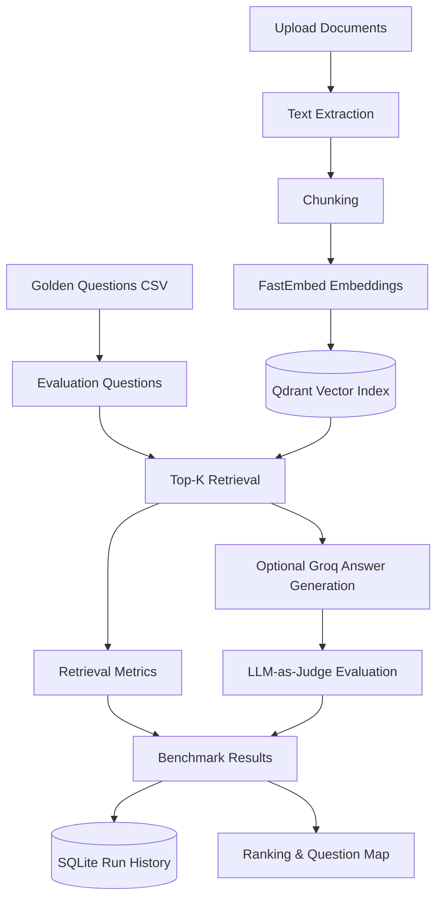

# RAGBench — RAG Evaluation & Benchmarking Platform

<p align="center">
  <strong>RAG without measurement ships confident mistakes.</strong>
</p>

<p align="center">
  Benchmark embedding models, chunk sizes, and retrieval configurations against your own documents and golden questions.
</p>

<p align="center">
  <a href="https://ragbench-zomw.onrender.com/"><strong>Live Demo</strong></a> ·
  <a href="https://github.com/Shaik-Saniya67/RAGBench"><strong>GitHub Repository</strong></a>
</p>

<p align="center">
  
  
  
  
  
  
  
  
</p>

---

## Overview

RAGBench is a web-based evaluation and benchmarking platform for Retrieval-Augmented Generation (RAG) systems.

Choosing an embedding model, chunk size, or Top-K value based on intuition can lead to poor retrieval quality and unreliable answers.

RAGBench addresses this problem by allowing users to upload their own documents and a golden evaluation dataset, experiment with different retrieval configurations, and compare their performance through quantitative metrics.

Instead of simply checking whether a RAG pipeline produces an answer, RAGBench helps evaluate whether the right information was retrieved and whether the generated answer is supported by that information.

## Features

| Feature | Description |
|---|---|
| Embedding model comparison | Compare multiple embedding models under the same evaluation dataset. |
| Configurable chunking | Experiment with different chunk sizes and overlap values. |
| Top-K comparison | Evaluate how many retrieved chunks provide the best results. |
| Retrieval evaluation | Measure Precision@K, Recall@K, Hit Rate, MRR, and latency. |
| LLM-based evaluation | Optionally evaluate faithfulness, relevancy, and correctness using Groq. |
| Custom document uploads | Upload multiple `.txt` and `.pdf` documents. |
| Golden question dataset | Upload a CSV containing questions, reference answers, source files, and evidence phrases. |
| Question-level analysis | Inspect individual questions and their retrieval outcomes across configurations. |
| Configuration ranking | Compare benchmark configurations and identify the strongest results. |
| Past runs | Persist benchmark results using SQLite and review previous experiments. |
| Docker deployment | Containerize the application for deployment. |
| CI/CD | Automate testing and Docker builds using GitHub Actions. |

## How It Works



### Benchmark workflow

1. Upload documents and a golden question CSV.
2. Select embedding models, chunk sizes, Top-K values, and overlap.
3. RAGBench creates an index for each selected model and chunk-size configuration.
4. Every evaluation question is executed against the selected configurations.
5. Retrieved chunks are compared against the expected source and evidence.
6. Retrieval metrics are calculated for each question and configuration.
7. Optionally, Groq generates answers and evaluates their quality.
8. Results are displayed through configuration rankings and a question-level comparison map.
9. Benchmark history is saved in SQLite.

## Supported Configurations

### Embedding models

- `sentence-transformers/all-MiniLM-L6-v2`
- `sentence-transformers/paraphrase-multilingual-MiniLM-L12-v2`
- `BAAI/bge-small-en-v1.5`

Embeddings are generated using FastEmbed rather than the PyTorch-based Sentence Transformers runtime.

### Chunk sizes

- 40 words
- 80 words
- 150 words
- 250 words

### Top-K values

- Top 1
- Top 3
- Top 5

### Overlap

Configure the number of overlapping words between consecutive chunks.

## Evaluation Metrics

### Retrieval metrics

| Metric | Description |
|---|---|
| Precision@K | Proportion of retrieved top-K chunks that are relevant. |
| Recall@K | Proportion of all relevant chunks retrieved within the top-K results. |
| Hit Rate | Proportion of questions for which at least one relevant chunk is retrieved. |
| Mean Reciprocal Rank (MRR) | Measures how highly the first relevant chunk is ranked. |
| Latency | Average time taken per evaluation question. |

### Answer quality metrics

Available when answer judging is enabled and a Groq API key is configured.

| Metric | Description |
|---|---|
| Faithfulness | Measures whether generated answer claims are supported by retrieved context. |
| Relevancy | Measures whether the generated answer addresses the question. |
| Correctness | Measures how closely the generated answer matches the reference answer. |

### Failure classification

RAGBench categorizes question-level outcomes into:

- **Answered well:** No retrieval or answer-quality failure was detected.
- **Retrieval miss:** No relevant chunk was found in the retrieved top-K results.
- **Hallucination:** A relevant chunk was retrieved, but the faithfulness score was below the configured threshold.
- **Incorrect answer:** A relevant chunk was retrieved, but the correctness score was below the configured threshold.

## Example Benchmark Results

The following results are from an actual run using an uploaded document collection and a 12-question golden evaluation dataset.

**Test configuration:** `all-MiniLM-L6-v2`, Top-K = 3, overlap = 10 words.

| Metric | 150-word chunks | 40-word chunks |
|---|---:|---:|
| MRR | **0.94** | 0.92 |
| Hit Rate | 1.00 | 1.00 |
| Precision@K | 0.33 | 0.39 |
| Recall@K | 1.00 | 1.00 |
| Faithfulness | 1.00 | 1.00 |
| Relevancy | 1.00 | 1.00 |
| Correctness | 1.00 | 1.00 |
| Latency per question | 3864 ms | 594 ms |

**Run summary:**
- 2 configurations evaluated.
- 24 question runs.
- 0 failed runs.

**Observation:** The 150-word configuration achieved a slightly higher MRR, while the 40-word configuration achieved higher Precision@K and lower observed latency.

These are results from one evaluation dataset, not universal performance guarantees. Results can vary with document content, question quality, and selected configurations.

## Using Your Own Data

RAGBench accepts:

**1. Documents**

- Plain text (`.txt`)
- PDF (`.pdf`)
- Multiple documents can be uploaded together.

**2. Golden evaluation CSV**

The CSV must contain the following columns:

| Column | Description |
|---|---|
| `question` | Evaluation question. |
| `reference_answer` | Expected answer used for answer evaluation. |
| `source` | Exact filename of the document containing the relevant information. |
| `evidence` | Short evidence phrase expected in the relevant passage. |

Example:

```csv
question,reference_answer,source,evidence
How long is parental leave?,16 weeks,employee_policy.txt,16 weeks
How long must a password be?,12 characters,security_policy.txt,12 characters
```

The `source` value must match an uploaded document filename.

Upload both documents and the golden CSV together. If neither is uploaded, the application can use its bundled sample dataset.

## Technology Stack

| Layer | Technology |
|---|---|
| Programming language | Python |
| Backend | FastAPI |
| ASGI server | Uvicorn |
| Embedding generation | FastEmbed |
| Embedding runtime | ONNX Runtime |
| Vector database | Qdrant |
| LLM integration | Groq API |
| Default Groq model | `openai/gpt-oss-120b` |
| Data processing | pandas |
| PDF extraction | pypdf |
| Persistent run history | SQLite |
| Frontend | HTML, CSS, JavaScript |
| Containerization | Docker |
| Testing | pytest |
| CI/CD | GitHub Actions |
| Deployment | Render |

## Running Locally

### Prerequisites

- Python 3.11+
- Git
- Internet connection for downloading embedding models on their first use

### 1. Clone the repository

```bash
git clone https://github.com/Shaik-Saniya67/RAGBench.git
cd RAGBench
```

### 2. Create a virtual environment

```bash
python -m venv .venv
```

Activate it:

**Windows:**

```powershell
.venv\Scripts\activate
```

**Linux / macOS:**

```bash
source .venv/bin/activate
```

### 3. Install dependencies

```bash
pip install -r requirements.txt
```

### 4. Configure environment variables

Create a `.env` file in the project root if you want to enable Groq answer generation and judging.

```env
GROQ_API_KEY=your_groq_api_key
GROQ_MODEL=openai/gpt-oss-120b
```

The Groq API key is optional for retrieval-only benchmarking.

### 5. Start the application

```bash
uvicorn main:app --reload
```

Open:

```text
http://localhost:8000
```

## Docker

Build the Docker image:

```bash
docker build -t ragbench .
```

Run the container:

```bash
docker run -p 8000:8000 ragbench
```

To enable Groq judging, provide your API key through an environment variable:

```bash
docker run -p 8000:8000 -e GROQ_API_KEY=your_groq_api_key ragbench
```

## Environment Variables

| Variable | Description |
|---|---|
| `GROQ_API_KEY` | Optional API key for Groq answer generation and judging. |
| `GROQ_MODEL` | Groq model identifier. Defaults to `openai/gpt-oss-120b`. |
| `QDRANT_URL` | Optional Qdrant server URL. Without it, the application uses an in-memory Qdrant instance. |
| `DB_PATH` | SQLite database file path. Defaults to `rageval.db`. |

## API Endpoints

The FastAPI backend exposes the following endpoints:

| Method | Endpoint | Description |
|---|---|---|
| GET | `/api/options` | Retrieves available benchmark options. |
| GET | `/api/history` | Retrieves saved benchmark history. |
| POST | `/api/run` | Executes a benchmark using the selected configurations and uploaded data. |
| GET | `/docs` | Interactive FastAPI API documentation. |

## Testing

Run the automated test suite:

```bash
pytest -q
```

The repository includes automated tests for core benchmarking functionality and API behavior.

## CI/CD Pipeline

RAGBench uses GitHub Actions to automate its development workflow.

The pipeline includes:

1. Dependency installation.
2. Automated test execution.
3. Docker image build.
4. Deployment hook integration when configured.

This helps validate code changes before deployment.

## Deployment

RAGBench is deployed on Render.

**Live application:**  
https://ragbench-zomw.onrender.com/

**Source code:**  
https://github.com/Shaik-Saniya67/RAGBench

## Project Structure

```text
RAGBench/
│
├── main.py
│
├── rageval/
│   └── core.py
│
├── web/
│   └── index.html
│
├── data/
│   ├── golden.csv
│   └── sample/
│
├── tests/
│   └── test_core.py
│
├── .github/
│   └── workflows/
│       └── ci-cd.yml
│
├── Dockerfile
├── requirements.txt
└── README.md
```

## Limitations

- Benchmark quality depends on the quality and coverage of the golden evaluation dataset.
- Evidence matching depends on the source filenames and evidence phrases provided by the user.
- LLM-as-a-judge scores are automated evaluation signals and should not be treated as absolute proof of answer correctness.
- Benchmark latency can vary with model loading, hardware resources, document size, and hosting conditions.
- The free hosting environment may experience cold starts and resource limitations.

---

<p align="center">
  <strong>Built by Shaik Saniya</strong>
  <br>
  Making RAG evaluation measurable, comparable, and easier to understand.
  <br><br>
  <a href="https://ragbench-zomw.onrender.com/">Live Demo</a> ·
  <a href="https://github.com/Shaik-Saniya67/RAGBench">GitHub</a>
</p>
